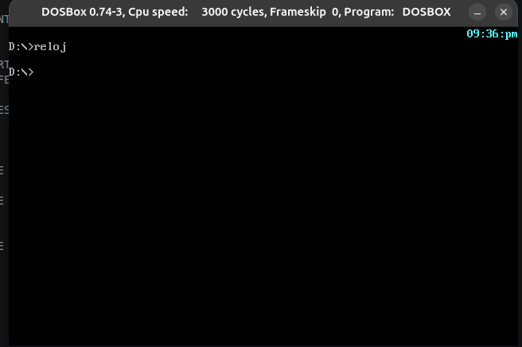

# Reloj TSR (Terminate and Stay Resident) en Ensamblador x86

Este proyecto es un programa de residente en memoria de tipo **TSR (Terminate and Stay Resident)** escrito en ensamblador x86 de 16 bits. El programa se instala en memoria, intercepta la interrupción del temporizador del sistema y muestra la hora actual directamente en la esquina superior derecha de la pantalla, sin interrumpir la ejecución de otros programas en DOS.



## Explicación Técnica (Arquitectura y Bajo Nivel)

> Este código es un excelente ejemplo de programación a nivel de sistema. Aquí se detallan los conceptos clave que implementa:

### 1. Enganche de Interrupciones (Interrupt Hooking)
El programa intercepta el vector de interrupción del temporizador del sistema (Tick del reloj, típicamente `INT 1Ch`). Guarda la dirección original (IP y CS) y coloca la dirección de su propia rutina (`CLK_INT`) en la tabla de vectores.

### 2. Lectura del Reloj del Sistema (BIOS Data Area)
En lugar de usar la interrupción de DOS, el programa lee directamente el contador de *ticks* del reloj desde la BIOS Data Area (`0040:006C`). Cada tick equivale a 1/18.2 segundos.

### 3. Conversión de Tiempo y BCD a ASCII
El programa realiza cálculos matemáticos para convertir los *ticks* en horas y minutos. Utiliza la instrucción **`AAM` (ASCII Adjust after Multiplication)** para separar un número en sus dos dígitos decimales y sumar `3030H` para obtener su representación en código ASCII.

### 4. Acceso Directo a Memoria de Video (Video RAM)
Para que el reloj se muestre sin usar `INT 21h` (lo cual sería lento y afectaría la ejecución), el programa escribe directamente en la memoria de video (segmento `B800h` para color o `B000h` para monocromo).

### 5. Sincronización por "Vertical Retrace"
Este es un detalle de altísimo nivel: antes de escribir en la memoria de video, el código lee el puerto de estado de la tarjeta gráfica (`3DAh` o `3BAh`) y espera a que el haz de electrones del monitor termine de dibujar la pantalla. Esto evita que el reloj "parpadee" o se vea con artefactos visuales.

### 6. Terminarse y Quedarse Residente (`INT 27h`)
Al final, el programa utiliza la interrupción `INT 27h` para indicarle al sistema operativo DOS que no libere la memoria utilizada por el código, dejando el reloj funcionando en segundo plano.

## Cómo ejecutarlo

1. Abre DOSBox y monta la carpeta donde se encuentra el código y MASM.
2. Compila y enlaza el programa:
   ```dos
   masm reloj.asm;
   link reloj.obj;
   reloj.exe
